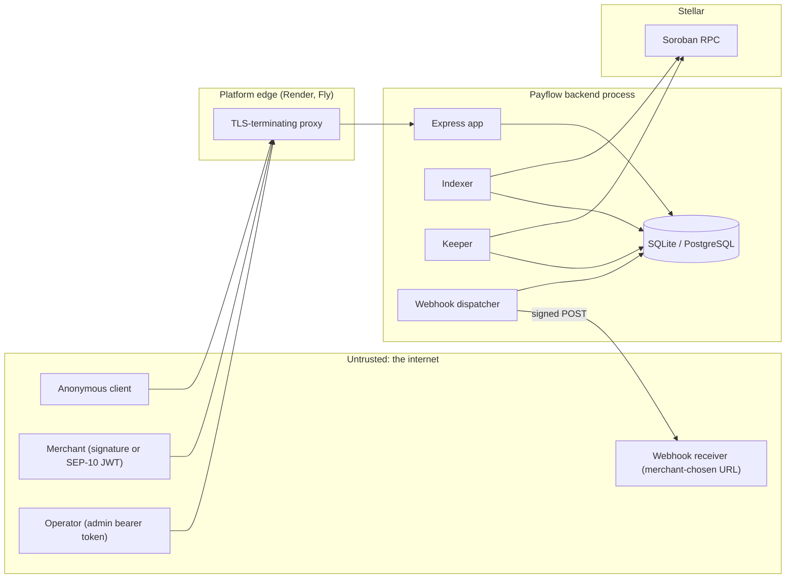

# Payflow Backend Threat Model

This document describes the attack surface of the backend's HTTP API: what it
protects, who can reach it, where the trust boundaries are, how each route
authenticates and authorizes a caller, and the risks that are known and not
yet addressed. It covers the code as it stands in `src/app.ts` and
`src/routes/*.ts`; when a route or a check changes, this file changes with it.

The service is unaudited and runs against testnet only (see
[SECURITY.md](../SECURITY.md)). Report a vulnerability privately as that file
describes, not in an issue.

---

## 1. Scope

In scope: every path the Express app serves — the read API under `/api/v1`
(and its `/api` and `/api/<network>` aliases), the SEP-10 sign-in, merchant
webhook management, the server-sent event stream, the operator routes under
`/admin`, and `/health`, `/ready`, `/version`, `/metrics` and the API
documentation.

Out of scope: the Soroban contracts (report those in `payflow-contract`), the
frontend, the keeper's transaction construction except where an API route
triggers it, and the availability of third-party RPC providers.

---

## 2. Assets

| Asset | Where it lives | Why it matters |
|---|---|---|
| `KEEPER_SECRET` (and `KEEPER_SECRET_NEXT`, `KEEPER_CHANNEL_SECRETS`) | Environment | Signs `charge` transactions. Holds only XLM for fees and has no on-chain privilege, but a leak lets an attacker spend that XLM. |
| `SEP10_SIGNING_KEY`, `SEP10_JWT_SECRET` | Environment | The first signs SEP-10 challenges; the second signs every merchant JWT. Either one leaking lets an attacker act as any merchant on the webhook routes. |
| `ADMIN_TOKEN`, `ADMIN_TOKENS` | Environment | Bearer tokens for the operator routes. |
| Webhook signing secrets | `webhooks.secret` and `previous_secret`, stored in plain text | Let a receiver verify `Payflow-Signature`. Anyone holding one can forge a delivery to that merchant. |
| Webhook registrations, delivery history, charge attempts, audit log | Database | Operational state. Unlike the projection, it **cannot** be rebuilt from chain. |
| The projection (plans, mandates, charges, vault events, raw events) | Database | Public data, re-derivable from chain. Its integrity matters more than its secrecy: merchants and dashboards read revenue and status from it. |
| RPC endpoint URLs | `SOROBAN_RPC_URL` | Providers often put an API key in the URL. |
| Service availability | — | The API, the indexer and the keeper share one process and one database. |

---

## 3. Actors

| Actor | Can reach | Proves identity with |
|---|---|---|
| Anonymous client | Every public read route, `/api/stream`, `/api/auth`, `/health`, `/ready`, `/version`, `/metrics` when enabled | Nothing |
| Merchant | The webhook routes | An ed25519 signature by the merchant address over a route-specific message, or a SEP-10 JWT |
| Operator | `/admin/*` | `Authorization: Bearer` with an admin token |
| Webhook receiver | Nothing on the API; it is called by the service | Verifies the service's HMAC signature |
| Soroban RPC node, archive | Nothing on the API; it is called by the service | Trusted (see 7.13) |
| Host / platform | Environment, database file, logs | — |

---

## 4. Trust boundaries

1. **Internet to the app.** Every request is untrusted. The app sets
   `trust proxy` to one hop, so it expects exactly one proxy in front of it
   (7.6).
2. **Merchant to the webhook routes.** The only routes that change state on a
   caller's request. A merchant must prove control of the address it names.
3. **Operator to `/admin`.** Routes that run passes, pause the indexer and
   delete data. They exist only when an admin token is configured.
4. **Service to webhook receivers.** The service makes outbound requests to
   URLs a merchant supplied (7.3, 7.4).
5. **Service to RPC.** The indexer trusts what RPC returns about the chain
   (7.13).
6. **Process to host.** Secrets come from the environment; the database file
   and the logs sit on the host.

---

## 5. Entry points

| Surface | Routes | Authentication | Notes |
|---|---|---|---|
| Public read API | `GET /api/v1/{plans,mandates,due,merchants,subscribers,stats,protocol,vault,tokens,events}…`, `GET /api/v1/mandates/:id/attempts`, `GET /api/v1/keeper` (with the keeper on) | None | Read-only views of the projection. Rate-limited per IP. |
| Event stream | `GET /api/v1/stream` | None | Server-sent events; at most 100 open streams per stream router (7.7). |
| SEP-10 sign-in | `GET`/`POST /api/v1/auth` | None to ask; the signed challenge to exchange | Mounted only with `SEP10_SIGNING_KEY`, `SEP10_JWT_SECRET` and `SEP10_HOME_DOMAIN` set. CORS `*` on these paths, as SEP-10 requires. |
| Webhook management | `POST /api/v1/webhooks`, `GET /api/v1/webhooks`, `DELETE /api/v1/webhooks/:id`, `POST /api/v1/webhooks/:id/{rotate,test}`, `GET /api/v1/webhooks/:id/deliveries` | Merchant signature or SEP-10 JWT | The only writes a caller can make. |
| Operator | `POST /admin/{reindex,keeper/run,indexer/pause,indexer/resume,data/prune}`, `GET /admin/{keeper/backoff,audit-logs,past-due}` | Admin bearer token | Absent (404) without `ADMIN_TOKEN`/`ADMIN_TOKENS`. Not rate-limited (7.1). |
| Probes and metadata | `GET /health`, `/ready`, `/version` | None | `/health` includes the RPC endpoint URLs (7.5). |
| Metrics | `GET /metrics` | None | Only with `METRICS_ENABLED=true` (7.12). |
| Documentation | `GET /api/openapi.json`, `/api/docs` and its scripts | None | Static, served from the process. |

Every route is also served under `/api/<network>/…` for each configured
network, against that network's database.

---

## 6. Authentication and authorization model

### Public reads

No authentication, by design: everything the read API serves is already
public on chain, or derived from it. Authorization is therefore "anyone may
read anything", including any merchant's revenue, subscribers and churn. A
change that adds data which is *not* public on chain to a read route breaks
this model and needs authentication of its own.

### Merchants

A webhook route acts for exactly one merchant address, proven in one of two
ways (`src/routes/webhooks.ts`, `src/routes/auth.ts`):

- **A signed message.** The merchant signs
  `<prefix>:<merchant>[:<url or id>]:<timestamp>` with the address's key and
  sends the base64 ed25519 signature. Each operation has its own prefix
  (`payflow-webhook`, `-list`, `-delete`, `-rotate`, `-test`, `-deliveries`,
  each `:v1`), so a signature for one operation cannot be replayed as
  another, and a registration signature covers the URL, so it cannot be
  reused for a different URL. The timestamp must be within ten minutes of the
  server's clock.
- **A SEP-10 JWT.** `GET /api/auth` issues a challenge valid for fifteen
  minutes; `POST /api/auth` exchanges the signed challenge for an HS256 JWT
  whose `sub` is the account and whose `iss` names this network's auth
  endpoint, so a token from one network is refused on another. For an account
  that exists, the signatures must meet its medium threshold (at least 1) from
  signers with weight above zero, so a disabled master key cannot sign in;
  for one that does not exist, only its master key can. An RPC failure while
  loading the account is an error, never "the account does not exist". Each
  challenge yields at most one token per process (7.9). Tokens live
  `SEP10_JWT_TTL_S` (60 s to 24 h, default 1 h).

Under a JWT, a `merchant` in the request, when present, must equal the
token's account. A webhook id that does not exist or belongs to another
merchant is a 404, so ids of other merchants are not revealed.

### Operators

`/admin` requires `Authorization: Bearer <token>`. Tokens are compared as
SHA-256 digests with `timingSafeEqual`, which leaks neither their length nor
the position of a mismatch; a token is never logged. `ADMIN_TOKEN` grants
everything. `ADMIN_TOKENS` entries may carry `scopes` (`reindex`, `keeper`,
`indexer`, `*`) and an `expiresAt`; an expired token is a 401 and a token
without the route's scope is a 403. Not every route checks a scope (7.2).

### The keeper

The keeper needs no API authorization: `charge` is permissionless on chain,
and the keeper key only pays fees. An operator can trigger a pass through
`/admin/keeper/run`; passes share one serialized runner with the scheduled
loop, so a trigger cannot race the account sequence.

---

## 7. Known risks

Each risk names the code it lives in, what an attacker gains, and what
contains it today. Risks marked **open** have no fix in the code yet; the
mitigation column says what an operator can do meanwhile.

| # | Risk | Severity | Status |
|---|---|---|---|
| 7.1 | `/admin` is outside the rate limiter | Medium | Open |
| 7.2 | Three admin routes ignore token scopes | Medium | Open |
| 7.3 | Webhook URLs can target internal addresses (SSRF) | Medium | Open |
| 7.4 | Webhook response bodies are read and stored without a size cap | Medium | Open |
| 7.5 | `/health` publishes the RPC endpoint URLs | Medium | Open |
| 7.6 | Per-IP limits trust one `X-Forwarded-For` hop | Low to medium | Deployment assumption |
| 7.7 | Rate limits and stream caps are per process | Low | By design |
| 7.8 | Signed-message proofs replay within their window and reach the logs | Low | Open |
| 7.9 | SEP-10 single-use is per process | Low | Open |
| 7.10 | JWTs cannot be revoked one by one | Low | By design |
| 7.11 | Webhook secrets are stored in plain text | Low | Open |
| 7.12 | `/metrics` has no authentication | Low | Opt-in |
| 7.13 | The projection trusts RPC | Low on testnet | By design |
| 7.14 | Expensive public reads | Low | Rate-limited |
| 7.15 | Merchant profiles are self-declared | Low | Documented |

### 7.1 `/admin` is outside the rate limiter

The limiter is mounted on `/api` only (`src/app.ts`), so `/admin`, `/health`,
`/ready`, `/version` and `/metrics` take unlimited requests. For `/admin` that
means unlimited guesses at a token. A failed attempt is logged as
`admin request rejected` with the method and path. **Mitigation:** use long
random tokens (they are compared as digests, so length costs nothing), keep
`/admin` unset where it is not needed, and restrict it at the proxy where the
platform allows.

### 7.2 Three admin routes ignore token scopes

`POST /admin/data/prune`, `GET /admin/audit-logs` and `GET /admin/past-due`
(`src/routes/admin.ts`) do not call `hasScope`, so any valid admin token runs
them, including one scoped to `indexer` only. `data/prune?days=0` deletes
every raw event with a close time; raw events older than the RPC retention
window cannot be fetched again. **Mitigation:** treat every admin token as
full access until these routes check a scope.

### 7.3 Webhook URLs can target internal addresses (SSRF)

A registration accepts any `http:` or `https:` URL
(`registrationSchema`), and the dispatcher `POST`s to it from inside the
service's network (`src/lib/webhooks.ts`). Loopback, private, link-local and
cloud-metadata addresses are not refused. The caller does not see the
response body, but `POST /api/webhooks/:id/test` answers with the status code,
latency and error, and `GET /api/webhooks/:id/deliveries` returns the status
code and error of every attempt. A status code, or the difference between a
refused connection and a timeout, is enough to map what the host can reach. Registering needs only a Stellar key, which anyone
can generate. **Mitigation:** run the service where its egress cannot reach
anything sensitive, and block metadata endpoints at the network level.

### 7.4 Webhook response bodies are read and stored without a size cap

A delivery reads the receiver's whole response (`res.text()`) and stores it in
`webhook_deliveries.response_body`. The 15-second timeout bounds the time, not
the size, so a hostile receiver can return a large body on every attempt and
grow memory and the database. The body is never returned by the API.
**Mitigation:** none in configuration; watch the database size.

### 7.5 `/health` publishes the RPC endpoint URLs

`/health` returns `rpc.active` and `rpc.endpoints` verbatim. A provider URL
that carries an API key in its path or query string is readable by anyone.
**Mitigation:** use RPC URLs that carry no credential, or a provider that
authenticates by header or allowlist.

### 7.6 Per-IP limits trust one `X-Forwarded-For` hop

`app.set("trust proxy", 1)` makes `req.ip` the address the nearest proxy
reports. Behind exactly one proxy (Render, Fly) that is the client. Exposed
directly, a client sets `X-Forwarded-For` itself and picks a new "IP" per
request, defeating the API rate limit. Behind two proxies, every client
shares the inner proxy's address. **Mitigation:** deploy behind exactly one
proxy, or change the setting to match the deployment.

### 7.7 Rate limits and stream caps are per process

`express-rate-limit` keeps its counters in memory, so N instances allow N
times `API_RATE_LIMIT_MAX`, and a restart resets them. The stream cap of 100
is per stream router: the default network is mounted twice (unprefixed and
under its own name), so it accepts up to 200 open streams, and each extra
network 100 more. An open stream counts once against the rate limit however
long it stays open. **Mitigation:** scale with a shared limiter at the proxy if
abuse appears.

### 7.8 Signed-message proofs replay within their window and reach the logs

A signed message is valid for ten minutes either side of the server's clock
and is not single-use: the same proof can be sent again within the window.
`GET /api/webhooks` and `GET /api/webhooks/:id/deliveries` take the proof in
the query string, and `pino-http` logs request URLs with their query, so those
proofs land in the logs (the `Authorization` header is redacted; query strings
are not). Someone who reads the logs, or captures a request, can list that
merchant's webhooks (URLs, last four characters of each secret) or read its
delivery history for up to ten minutes. The prefixes keep a list proof from
working as a delete or rotate. **Mitigation:** prefer SEP-10 JWTs, sent in the
redacted header, over query-string proofs.

### 7.9 SEP-10 single-use is per process

Redeemed challenges are remembered in a map inside the process
(`Sep10Auth.redeemed`). Another instance, or the same one after a restart,
does not know them, so a signed challenge can be exchanged once per instance
while it is valid (15 minutes plus the SDK's 5-minute grace). Every token it
yields is for the account that signed it, so this gives the holder of a
captured, signed challenge a token, not another account's access.

### 7.10 JWTs cannot be revoked one by one

There is no token store: a JWT stays valid until `exp`. Rotating
`SEP10_JWT_SECRET` invalidates every token at once and is the only kill
switch. Keep `SEP10_JWT_TTL_S` short.

### 7.11 Webhook secrets are stored in plain text

`webhooks.secret` and `previous_secret` are stored as given, because the
dispatcher needs them to sign. The API returns only their last four
characters, but the database file, its backups and any PostgreSQL replica hold
them whole. **Mitigation:** protect the database and its backups as secrets,
not as a public projection.

### 7.12 `/metrics` has no authentication

With `METRICS_ENABLED=true`, `/metrics` serves indexer, keeper and business
gauges (active mandates, merchants, MRR) to anyone. The figures are derived
from public data, but they also describe the service's health and keeper
activity. **Mitigation:** enable it only where the scraper can reach it
privately, or restrict the path at the proxy.

### 7.13 The projection trusts RPC

The indexer projects whatever events the RPC node returns. Event-spec
validation (`src/lib/event_spec.json`) catches events of the wrong shape, not
false ones, and the reconciler re-reads mandate state through the same RPC.
A malicious or compromised RPC node can make the API report wrong balances,
charges and statuses. It cannot move funds: the keeper's `charge` is
validated by the contract. Several `SOROBAN_RPC_URL` entries are failover, not
a quorum. **Mitigation:** use an RPC provider you trust; on mainnet, treat
API figures as a view and the chain as the record (see SECURITY.md).

### 7.14 Expensive public reads

Some public reads cost far more than a page: the CSV exports stream a
merchant's or subscriber's whole history, the reports aggregate over it, and
`/api/events?name=` decodes topics in batches of 200 until it fills a page,
so a name that rarely occurs scans much of the table. All of them sit behind
the per-IP limit, with the caveats in 7.6 and 7.7.

### 7.15 Merchant profiles are self-declared

`GET /api/merchants/:address/profile` returns the name and URL a merchant set
on chain with `set_profile`. Neither the contract nor the API verifies them,
so a merchant can claim another's name. Consumers must show the address
beside the name.

---

## 8. Controls in place

- **Input validation.** Route parameters are parsed with zod
  (`src/routes/validate.ts`); every address is checked as a StrKey with its
  checksum; ids, limits and cursors are bounded; unknown query keys on
  `/api/events` are refused.
- **Bounded bodies.** JSON and form bodies are capped at 64 kB.
- **Fixed error bodies.** The error boundary (`errorHandler` in
  `src/app.ts`) answers every unexpected failure with a fixed
  `internal_error`, never `err.message`, which can carry SQL values or RPC
  URLs; the logged error is rebuilt by `loggableError` so a request body never
  reaches the logs.
- **Log redaction.** `KEEPER_SECRET`, `SEP10_SIGNING_KEY`, `SEP10_JWT_SECRET`,
  any `secret` field and `req.headers.authorization` are redacted at the top
  level and one level down (`src/lib/logger.ts`). The SEP-10 keys are kept in
  JavaScript private fields, so serialising the auth object cannot write them.
- **Security headers.** `helmet` sets its default headers and CSP. `/api/docs`
  adds only `worker-src 'self' blob:`, and the ReDoc bundle is served by the
  process, not a CDN.
- **CORS.** `CORS_ORIGIN` (default `*`) applies to the API; SEP-10 paths are
  always `*`, as the spec requires. No route reads a cookie, so a permissive
  origin does not expose an authenticated session.
- **Caching.** Read routes answer `Cache-Control: public, max-age=5`; the
  webhook listing, SEP-10 answers, the stream, `/health` and `/ready` are
  `no-store`.
- **Signed deliveries.** Each webhook delivery carries an HMAC-SHA256
  `Payflow-Signature` over the payload and an `Idempotency-Key`. A rotated
  secret keeps signing beside the new one for `WEBHOOK_SECRET_OVERLAP_S`. The
  signature covers no timestamp, so a captured delivery verifies again later:
  receivers must drop an `Idempotency-Key` they have already processed.
- **Opt-in surfaces.** `/admin`, `/metrics`, SEP-10 and the keeper are absent
  unless configured.

---

## 9. Changing the API safely

- A new read route must serve only data that is public on chain, or come with
  authentication; add it to section 5.
- A new write route needs a merchant proof (a signed message with its own
  prefix, or a SEP-10 JWT) or an admin token with a scope check, and an entry
  in section 5.
- A new admin route must call `hasScope` for a named scope.
- A new outbound request to a caller-chosen destination inherits 7.3 and 7.4.
- A new field in `/health` or `/version` is public; it must not carry a URL
  or anything read from a secret.
